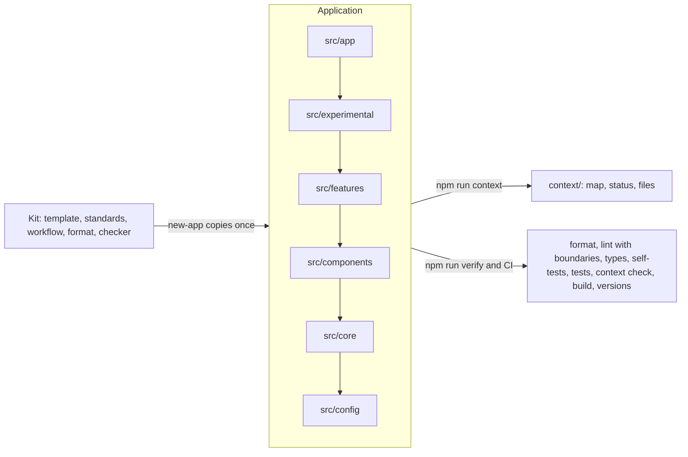

# Harness architecture

The kit holds the contract, standards, an application template, the scaffold
that applies it, the version checker and their tests. It has no application
runtime; each application owns its code, data, dependencies and verification.

## Owners

| Responsibility                     | Owner                                                                                             |
| ---------------------------------- | ------------------------------------------------------------------------------------------------- |
| Kit contract                       | [AGENTS.md](../AGENTS.md)                                                                         |
| Workflow and quality principles    | [WORKFLOW.md](WORKFLOW.md)                                                                        |
| Engineering and language standards | [standards](../.harness/standards/BASE.md)                                                        |
| Application template               | [templates/nextjs](../.harness/templates/nextjs/README.md)                                        |
| Scaffold                           | [new-app.mjs](../scripts/new-app.mjs)                                                             |
| Document format                    | [FORMAT.md](../project/FORMAT.md)                                                                 |
| Stable application versions        | [checker](../scripts/check-framework-versions.mjs), [tests](../tests/framework-versions.test.mjs) |
| Kit failure probes                 | [native checks](../tests/native-checks.test.mjs), [scaffold](../tests/scaffold.test.mjs)          |

## Kit and application

`new-app` writes only into the target directory. For a new app it runs
`create-next-app`, replaces that tool's lint, TypeScript and agent files,
installs and pins dependencies. For an existing app it adds missing files and
scripts and reports what to merge; it never overwrites or installs. After that
the app owns every copied file: there is no sync.

## Inside an application

- **Boundaries.** `eslint.boundaries.mjs` turns the folders under `src/` and
  `src/config/features.json` into `import/no-restricted-paths` zones. Adding a
  feature or experiment folder extends the rules without editing them.
- **Experiments.** `src/config/experiments.ts` is metadata only.
  `src/core/experiments.ts` is the single decision: stage (`off`, `testers`,
  `everyone`), whether the person is a tester (`EXPERIMENT_TESTERS`, or everyone
  under `next dev`), the `billed` flag and the person's explicit choice. Choices
  are stored by an app-implemented `ExperimentChoiceStore`; a missing choice
  follows the default. Routes and Server Actions call `requireExperiment`.
- **Documents.** One README per feature, part and experiment, in the format of
  `docs/FORMAT.md`. `tests/documents.test.mjs` checks the tree, the feature
  registry (no unknown names, no cycles), open-item states and token budgets.
- **Context.** `scripts/context.mjs` reads the READMEs, code exports, tests and
  routes and writes `context/README.md`, `status.md` and `files.md`. CI fails
  when they are stale. It infers nothing it cannot read: purpose comes from each
  README's first sentence, tests are matched by file name and imports.

## Evidence boundaries

Kit tests exercise the scaffold in layer mode, the generators, the document and
context checks and the experiment decision, offline. ESLint boundaries, types
and the build need Next.js and run in an application: the template's
`tests/boundaries.test.mjs` proves eleven forbidden imports fail there. The
[Data Miner walkthrough](architecture/data-miner.md) remains an example of the
architecture view format applied to an existing application.
